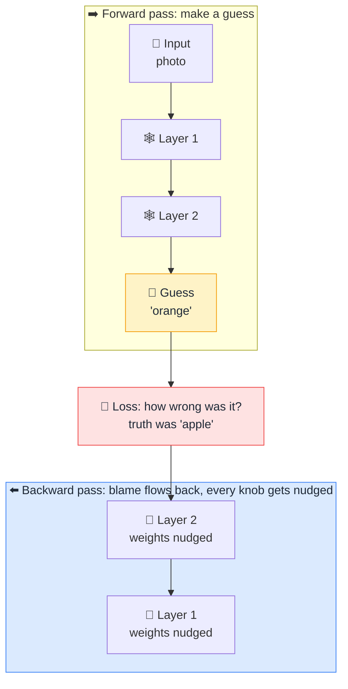

# 🔙 Backpropagation

> **🧒 Explain Like I'm 5:** The AI makes a guess, someone tells it how wrong it was, and that "how wrong" message travels backwards through the machine so every knob knows which way to turn.

## 🖼️ The Picture

## 🔧 How it actually works

**Backpropagation** is the learning step of [training](training-vs-inference.md), and it happens in two passes. Forward: the input travels through the [network](neural-network.md) and out comes a guess. Then a **loss function** measures the gap between that guess and the right answer as a single number, the *loss*. Big number, badly wrong. Small number, nearly right.

The clever part is the backward pass. Using calculus (the chain rule), the network works out, for every single one of its [weights](parameters-weights.md), how much that particular weight contributed to the error, and in which direction it should move to make the error smaller. That list of "nudge directions" is called the *gradient*, and an optimizer applies it, shifting every weight a tiny step downhill. That step size is the **learning rate**: too big and the model overshoots and thrashes, too small and it learns at a crawl.

Repeat that loop billions of times over billions of examples and the knobs drift into a configuration that gets things right. That is the whole of "learning" in a modern model: no understanding, no insight, just error measured, blame assigned backwards, knobs nudged, over and over, at enormous scale. It is also why training needs so many [GPUs](gpu.md): that backward pass is run for every example.

## 🌍 Real-world example

It is how a spam filter sharpens up over time, how an image model learns cats are not dogs, and how every [LLM](llm.md) you have ever used was trained. Backpropagation from the 1980s is still the engine underneath it all.

## 🔗 Related

- [Neural Network](neural-network.md)
- [Training vs Inference](training-vs-inference.md)
- [Parameters / Weights](parameters-weights.md)
- [Overfitting](overfitting.md)
