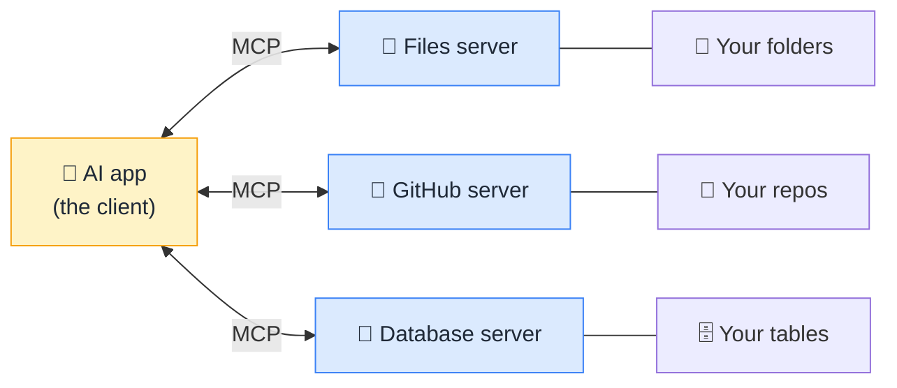

# 🔌 MCP (Model Context Protocol)

> **🧒 Explain Like I'm 5:** It's the USB-C port for AI. Before it, every tool needed its own custom cable for every AI. Now there's one shape that fits everything.

## 🖼️ The Picture

## 🔧 How it actually works

[Tool calling](tool-calling.md) gave models hands. The problem was that every AI app wired up its tools its own way, so connecting five apps to five services meant twenty-five bespoke integrations. **MCP**, an open standard introduced by Anthropic in late 2024, fixes that by agreeing on one common language between them.

It has two sides. A **server** wraps some capability (your filesystem, a Slack workspace, a Postgres database, a web search) and advertises what it offers: *tools* it can run, *resources* it can read, and *prompts* it can supply. A **client** is the AI application (a chat app, a coding assistant, an [agent](ai-agent.md)) that connects to those servers, sees the menu, and lets the model call whatever it needs. Write a server once and every MCP-speaking AI can use it.

Two things are worth keeping straight. First, MCP is plumbing, not intelligence: it standardises *how* a tool is offered, while the model still decides *whether* to use it. Second, connecting a server grants real access to real systems, and any text that comes back from one is untrusted input, which makes [prompt injection](prompt-injection.md) a genuine concern. Connect servers you trust, and prefer read-only ones when you can.

## 🌍 Real-world example

When a coding assistant can read your local repo, open your issue tracker, and query your staging database without anyone hand-building those three integrations, that is usually MCP servers doing the work.

## 🔗 Related

- [Tool Calling](tool-calling.md)
- [AI Agent](ai-agent.md)
- [Prompt Injection](prompt-injection.md)
- [System Prompt](system-prompt.md)
