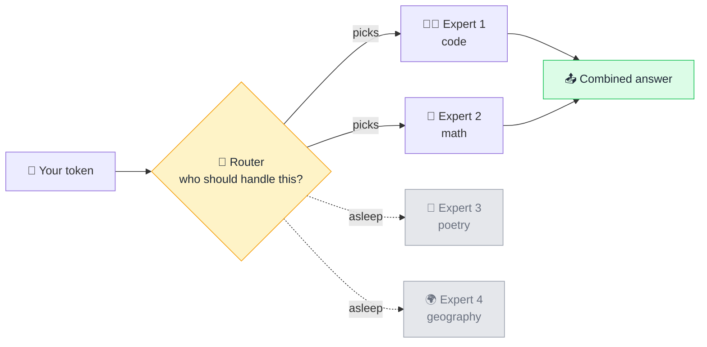

# 🧩 Mixture of Experts (MoE)

> **🧒 Explain Like I'm 5:** Instead of one know-it-all answering every question, there's a room full of specialists and a receptionist who wakes up only the two who actually know the topic.

## 🖼️ The Picture

## 🔧 How it actually works

A normal model pushes every [token](token.md) through *all* of its [parameters](parameters-weights.md). That is thorough, but expensive: a 500-billion-parameter model would do 500 billion parameters' worth of math for the word "the". **Mixture of Experts** splits parts of the [neural network](neural-network.md) into many smaller sub-networks, called *experts*, and adds a tiny **router** that decides which ones each token should visit.

Typically only two experts out of dozens are activated per token. So a model can *store* a huge amount of knowledge (high total parameter count) while only *using* a small slice of it for any given word (low "active" parameter count). That is why you see models described as something like "400B total, 30B active": the first number is how much it knows, the second is how much it costs to run.

The experts are not neatly labelled "the math one" or "the French one". The router learns its own routing during training, and the specialisms that emerge are usually statistical patterns no human would name. The trade-off is memory: you still have to load every expert into [GPU](gpu.md) memory, even the sleeping ones, so MoE saves compute rather than space.

## 🌍 Real-world example

Many of today's fastest large models (Mixtral, DeepSeek, and several frontier models) are MoE under the hood. It is a big part of why answers got quicker and cheaper without models getting dumber.

## 🔗 Related

- [Parameters / Weights](parameters-weights.md)
- [Neural Network](neural-network.md)
- [Transformer](transformer.md)
- [GPU](gpu.md)
