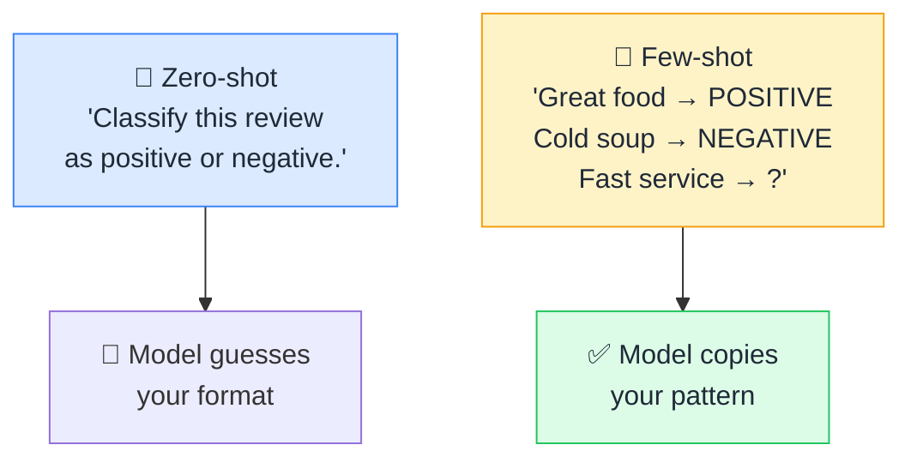

# 🎯 Zero-shot vs Few-shot

> **🧒 Explain Like I'm 5:** Zero-shot is "just do it." Few-shot is "here are three finished examples, now do the fourth one like those."

## 🖼️ The Picture

## 🔧 How it actually works

A "shot" is an example you include in the [prompt](prompt.md). **Zero-shot** means you describe the task and nothing else: "Translate this to French." **Few-shot** means you paste in two to five worked examples first, then the real input, and let the model infer the pattern from them. **One-shot** is just the version with exactly one example.

Nothing is being trained here. The [weights](parameters-weights.md) never change. The examples simply sit in the [context window](context-window.md) and steer the model's next-word predictions, which is why this is sometimes called *in-context learning*: learning that lasts exactly one conversation and then evaporates.

The practical rule: reach for few-shot when the *format* matters more than the knowledge. If you need output shaped a specific way (a particular JSON layout, a house tone of voice, an unusual label set, an edge case handled your way), showing beats telling. Zero-shot is shorter, cheaper, and usually fine for common tasks the model has seen a thousand times. And if you find yourself pasting fifty examples into every single call, that is the signal it is time for [fine-tuning](fine-tuning.md) instead.

## 🌍 Real-world example

Asking an AI to "summarize this email" is zero-shot. Giving it three of your own past summaries first, so the fourth one comes back in your voice and your bullet style, is few-shot. Same model, very different output.

## 🔗 Related

- [Prompt](prompt.md)
- [Context Window](context-window.md)
- [Fine-tuning](fine-tuning.md)
- [Chain of Thought](chain-of-thought.md)
